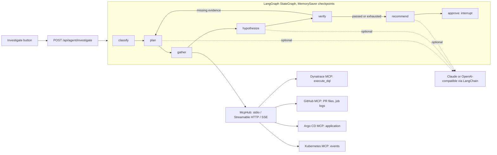
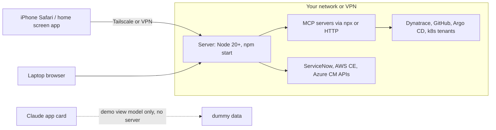

# Architecture

Product Journey traces every change from merge to verified in production, explains failures, scores risk before deploy, checks code against official best practices and shows cost, for product teams and leadership. Four layers:

| Layer | Package | Runs where |
|---|---|---|
| Data capture | `apps/server` collector + `packages/agent` McpHub | server (laptop, VM or k8s) |
| Engines (six phases) | `packages/core` | server, and at build time for the demo |
| Agent (LangGraph + MCP) | `packages/agent` | server |
| UI (plain JS, one view model) | `apps/web` | any browser: iPhone Safari, laptop, Claude app card (demo) |

```mermaid
flowchart LR
  subgraph Sources
    SN[ServiceNow CMDB + change_request]
    GH[GitHub PRs, jobs, contents]
    DT[Dynatrace Grail: problems, SDLC events, metrics, DORA, billing]
    AR[Argo CD applications]
    K8[Kubernetes events]
    AW[AWS Cost Explorer]
    AZ[Azure Cost Management]
  end
  subgraph Tiers["per source, first available wins: live API | live MCP | MCP snapshot | dummy"]
    AD[server adapters: REST APIs]
    HUBC[app MCP client: McpHub]
    MCP[Cursor MCP agents -> /api/ingest]
    FX[seeded fixtures -> native payloads]
  end
  Sources --> AD
  Sources --> HUBC
  Sources --> MCP
  AD --> RAW[(RawBundle, native schemas)]
  HUBC --> RAW
  MCP --> RAW
  FX --> RAW
  RAW --> MAP[core/sources.ts mappers]
  MAP --> DS[(Normalized dataset)]
  DS --> J[Journey + DORA]
  DS --> F[Failures + risk]
  DS --> C[Codebase rules + runtime joins]
  DS --> $[Cost]
  J & F & C & $ --> SC[Scorecards]
  J & F & C & $ & SC --> VM[View model, one compact JSON]
  VM --> API[REST API, gzip]
  API --> UI[Plain-JS UI: phone + laptop]
  VM --> PAGE[Published page, embedded VM]
  API --> AI[AI brief: evidence pack -> LLM -> validate]
```



## Principles

1. **Native schemas end to end.** Dummy data is not a simplified model; it is the scenario dataset rendered into each source's real payload shape. The same mappers run for every tier, and a round-trip test guards them.
2. **CMDB is identity.** Every join (repo, service, namespace, cost tag) starts from `cmdb_ci_business_app`.
3. **Dynatrace is the hub and is read only.** DORA from Dynatrace wins over the computed value; disagreement above 25% is surfaced as drift.
4. **Deterministic first.** Categories, findings, scores and savings come from rules with official references. The LLM explains and ranks and is validated against the evidence pack.
5. **Reuse before build.** The cache-aside rule checks for an existing ElastiCache line before proposing one. Adapters use the AWS CLI credential chain instead of new secrets.

## Joins

| From | To | Key |
|---|---|---|
| PR, job, SDLC event | product | repo in CMDB `u_repositories` |
| Problem | product | affected entity name in `u_dynatrace_services` |
| Problem | deployment | same product, prod deployment finished up to 60 min before problem start |
| Change request | journey | `correlation_id` = merge commit SHA |
| k8s event, workload | product | namespace in `u_k8s_namespaces` (with `-staging`/`-dev` suffixes) |
| Cost line | product | cost allocation tag `product` = `u_cost_tag` |

## Change failure rate and MTTR

- A change deployment is a prod deployment whose SHA has a merge. Rollbacks and redeploys are remediation and excluded from the denominator.
- A change failed if its prod deployment failed or rolled back, or a Dynatrace problem correlated to it.
- MTTR is the median duration of change-caused problems.

## Cost of failed changes

Downtime minutes of change-caused problems x the product's downtime cost per minute from the CMDB (slowdowns weighted 0.25), plus failed CI minutes x runner rate.

## Agentic layer (packages/agent)



- The model chooses evidence kinds and writes the explanation. It never writes queries, never picks tool arguments and never invents rule ids: parameters come from the analysis, and verify and recommend reject anything not grounded in gathered evidence.
- The same McpHub serves the collector's `mcp` tier, so one MCP configuration feeds both the dashboards and the agent.
- Node functions live in `nodes.ts` without any framework import, so the logic is unit tested on its own; `graph.ts` only wires them into LangGraph.


## Runtime topology



- The server holds all tokens and runs the MCP servers; nothing secret reaches the browser.
- Phones are clients: dashboards, Investigate, Approve or Reject. They cannot host the server or MCP servers.
- The server has no login yet: keep it behind VPN or Tailscale until SSO is added.

## Guardrails summary

| Concern | Control |
|---|---|
| Writes to source systems | MCP tools that look like writes are refused unless in `AGENT_WRITE_ALLOWLIST`; Dynatrace never writable |
| Hallucinated causes | verify node checks citations, runtime confirmation and figures against gathered evidence |
| Hallucinated actions | actions citing rule ids outside the evidence are dropped |
| Free-form queries | the model picks evidence kinds only; DQL and tool arguments come from templates filled from the analysis |
| Cost and latency | MCP calls time-limited and size-capped; plan/gather/verify loop capped by `AGENT_MAX_ITERATIONS` |
| Audit | every MCP call logged with server, tool, args, duration and outcome (`GET /api/agent/status`) |
| Human control | LangGraph `interrupt()` before any recommendation is final |

## AI layer additions: RAG, memory, guardrails, evaluation, tracing

```
failure -> classify -> plan -> gather ----------------------------> hypothesize -> verify -> recommend -> guard -> approve
                                 |  MCP or loaded data (snapshot)                                  tier 1 always    |
                                 |  kb_search -> knowledge base                                     tier 2 if flagged|
                                 |     incidents (one chunk each)                                                   v
                                 |     runbooks (by heading)          <-------- approved investigations ---- feedback log
                                 |     BM25 + vector, RRF, filters                (long-term memory)
every step, model call and tool call -> Tracer -> OTLP/HTTP -> Dynatrace (OpenTelemetry GenAI attribute names)
```

- **Knowledge base** (`packages/agent/src/rag`): built from ServiceNow-shaped incident and kb_knowledge records whenever the data is re-collected; dummy records generated from the analysis until ServiceNow is connected. In memory by default; `PGVECTOR_DDL` is the production schema.
- **Tool output is untrusted:** instruction-like lines are removed before any model sees them and the evidence is flagged.
- **Evaluation gate:** `npm run eval` in CI; see docs/AI-PATTERNS.md for the metrics and the published pattern behind each capability.
- **The card runs the same:** knowledge base, local embedder, tracer and memory all run inside the page.
